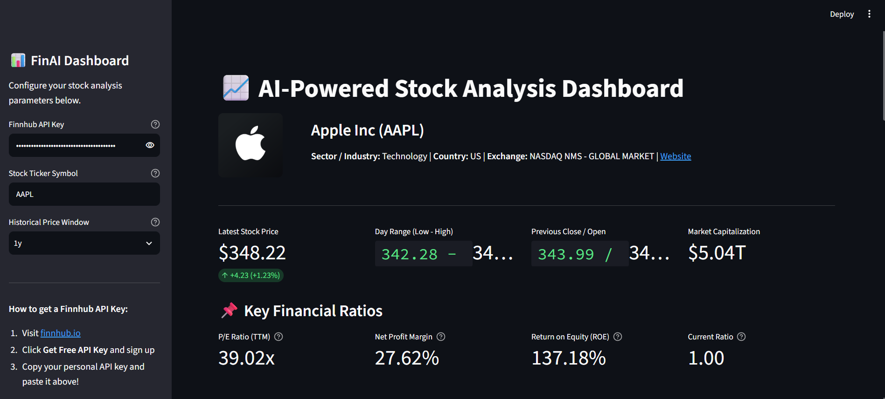
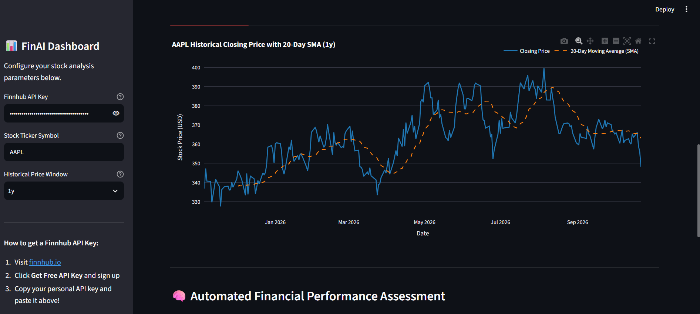

# AI-Powered Stock Analysis Dashboard (Project 1)

> **Course:** Finance & Financial Technology  
> **Author:** Aiden  
> **Development Tooling:** Built and debugged with **Google Antigravity** (Advanced AI Coding Agent)

---

## 📌 Executive Summary & Purpose

### The Financial Problem
Retail investors, finance students, and market analysts frequently face **information fragmentation**:
- Key company profile data and live quotes are located on real-time market feeds.
- Fundamental financial ratios (such as P/E multiples, profit margins, and return on equity) are buried across quarterly 10-Q/10-K SEC filings.
- Historical price movements and downside risk metrics (such as volatility and maximum drawdown) require custom statistical modeling in spreadsheets or scripts.

### The Solution
The **AI-Powered Stock Analysis Dashboard** consolidates real-time market data, company fundamentals, technical indicators, and quantitative risk metrics into a unified, interactive web application. Built with **Streamlit**, **Plotly**, the **Finnhub REST API**, and **Yahoo Finance (`yfinance`)**, the dashboard automatically ingests, computes, visualizes, and assesses any publicly traded U.S. equity in real time.

---

## 📸 Application Screenshots

Below are screenshots demonstrating the live application in action:

### 1. Dashboard Overview & Company Profile

*Figure 1: Real-time company profile, quote metrics (price, day range, market cap), and 4 key financial ratios.*

### 2. Historical Technicals, Risk Analytics & Automated Assessment

*Figure 2: Historical price with 20-Day SMA overlay, key ratios bar chart, quantitative risk indicators (volatility, max drawdown), and automated written financial commentary.*

---

## 🚀 Key Features

1. **Company Profile & Identity**:
   - Company name, official logo, exchange, country, industry sector, and direct website link retrieved dynamically from Finnhub.
2. **Live Market Price & Daily Activity**:
   - Current price, dollar change, percentage change, day low/high range, previous close, and total market capitalization.
3. **Core Fundamental Ratios**:
   - Four essential corporate health metrics: **P/E Ratio (TTM)**, **Net Profit Margin (%)**, **Return on Equity (ROE) (%)**, and **Current Ratio**.
4. **Quantitative Risk & Trend Analytics**:
   - **20-Day Simple Moving Average (SMA)**: Smoothed technical trend overlay.
   - **Annualized Volatility**: Compounded risk annualized across 252 market trading days.
   - **Maximum Drawdown**: Worst historical peak-to-trough decline over the selected time window.
   - **Cumulative Return**: Total holding-period return across the chosen timeframe.
5. **Dual Interactive Plotly Visualizations**:
   - **Chart 1 (Stock Price & 20-Day SMA)**: Interactive time-series price line chart with hover tooltips and 20-day moving average overlay.
   - **Chart 2 (Key Financial Ratios)**: Categorical bar chart comparing valuation, margin, shareholder return, and liquidity metrics with direct value callouts.
6. **Automated Written Financial Assessment**:
   - Automated analytical synthesis evaluating valuation (P/E), profitability (margin & ROE), balance sheet liquidity (current ratio), and risk (volatility & drawdown).
7. **Hardened Security & Network Resilience**:
   - Windows SSL bypass for corporate/school proxy networks.
   - Redaction engine that guarantees API keys are **never** displayed on screen or inside error traces.
   - Multi-tier fallback ladder ensuring charts always render smoothly.

---

## 🔌 API Documentation & Architecture

The application communicates with two distinct external market data providers:

### 1. Finnhub Stock REST API
- **Endpoint: `/api/v1/stock/profile2`**
  - **Purpose:** Ingests official company profile data including official name, ticker symbol, logo URL, industry classification, currency, exchange, and market capitalization in millions USD.
- **Endpoint: `/api/v1/quote`**
  - **Purpose:** Ingests real-time intraday quote statistics: `c` (current price), `d` (change), `dp` (percent change), `h` (high price), `l` (low price), `o` (open price), and `pc` (previous close).
- **Endpoint: `/api/v1/stock/metric?metric=all`**
  - **Purpose:** Fetches comprehensive corporate financial metrics (trailing-twelve-months P/E, net margin, return on equity, and quarterly current ratio).
- **Endpoint: `/api/v1/stock/candle`**
  - **Purpose:** Serves as a primary fallback to retrieve daily historical OHLCV data directly from Finnhub if Yahoo Finance is rate-limited or blocked.

### 2. Yahoo Finance API (`yfinance`)
- **Purpose:** Ingests historical daily closing prices across multiple lookback windows (`1mo`, `3mo`, `6mo`, `1y`, `2y`, `5y`) for statistical risk calculations and technical chart plotting.
- **Resilience:** Requests are issued using custom unverified HTTP sessions to bypass Windows certificate authority restrictions.

---

## 📐 Financial Concepts & Mathematical Formulas

### 1. Price-to-Earnings (P/E) Ratio
$$\text{P/E Ratio} = \frac{\text{Current Market Share Price}}{\text{Earnings Per Share (EPS)}}$$
- **Interpretation:** Measures how much investors are willing to pay per dollar of earnings. A high P/E (> 25–30x) suggests higher expected future growth, while a lower P/E (< 15x) may indicate value pricing or lower market growth expectations.

### 2. Net Profit Margin (%)
$$\text{Net Profit Margin} = \left( \frac{\text{Net Income}}{\text{Total Revenue}} \right) \times 100\%$$
- **Interpretation:** The percentage of each dollar of revenue remaining after all operating expenses, interest, taxes, and preferred dividends are deducted. Higher margins reflect competitive pricing power and cost discipline.

### 3. Return on Equity (ROE) (%)
$$\text{ROE} = \left( \frac{\text{Net Income}}{\text{Shareholders' Equity}} \right) \times 100\%$$
- **Interpretation:** Measures how efficiently corporate management deploys shareholder capital to generate profits. An ROE consistently above 15–20% is widely regarded as a benchmark of capital efficiency.

### 4. Current Ratio (Liquidity)
$$\text{Current Ratio} = \frac{\text{Current Assets}}{\text{Current Liabilities}}$$
- **Interpretation:** Evaluates short-term liquidity and solvency within a 12-month horizon. A ratio above 1.0 indicates that short-term assets exceed upcoming short-term obligations, while a ratio above 1.5 indicates a comfortable liquidity buffer.

### 5. 20-Day Simple Moving Average (SMA-20)
$$\text{SMA}_{20, t} = \frac{1}{20} \sum_{i=0}^{19} P_{t-i}$$
- **Interpretation:** Calculates the arithmetic mean closing price over the trailing 20 trading days. It filters out short-term market noise to reveal the underlying intermediate trend.

### 6. Annualized Volatility
$$\sigma_{\text{daily}} = \sqrt{\frac{1}{N-1} \sum_{t=1}^{N} (R_t - \bar{R})^2}$$
$$\sigma_{\text{annualized}} = \sigma_{\text{daily}} \times \sqrt{252} \times 100\%$$
- **Interpretation:** Measures the dispersion of daily returns ($R_t$) scaled by $\sqrt{252}$ (the number of trading days in a typical year). Volatility quantifies market risk and price uncertainty.

### 7. Maximum Drawdown (MDD)
$$\text{Drawdown}_t = \frac{\text{Cumulative Return}_t - \max_{\tau \le t} (\text{Cumulative Return}_\tau)}{\max_{\tau \le t} (\text{Cumulative Return}_\tau)}$$
$$\text{Max Drawdown} = \min_{t} (\text{Drawdown}_t) \times 100\%$$
- **Interpretation:** The largest observed percentage decline from an asset's peak to its subsequent trough before a new peak is achieved. It represents downside capital risk for investors holding the stock during that period.

---

## 💻 Installation & Setup Guide

### 1. Prerequisites
- **Operating System:** Windows 10/11, macOS, or Linux.
- **Python:** Python 3.10, 3.11, 3.12, or 3.13.

### 2. Clone or Navigate to the Project Directory
```powershell
cd c:\Users\aiden\OneDrive\Desktop\Stock-App
```

### 3. Create and Activate a Virtual Environment
```powershell
# Create the virtual environment
python -m venv .venv

# Activate on Windows (PowerShell):
.\.venv\Scripts\Activate.ps1
```

### 4. Install Dependencies
```powershell
pip install -r requirements.txt
```
The dependencies in `requirements.txt` are:
- `streamlit`: Web dashboard framework.
- `requests`: HTTP library for Finnhub REST calls.
- `yfinance`: Yahoo Finance historical market data library.
- `pandas`: Data manipulation and time-series indexing.
- `plotly`: Interactive financial charts and hover tooltips.
- `python-dotenv`: Environment variable management.

### 5. Obtain a Free Finnhub API Key
1. Sign up for a free account at [finnhub.io](https://finnhub.io).
2. Copy your personal API key from the dashboard.
3. You can either:
   - Paste it directly into the **Sidebar** input field in the web browser, or
   - Create a local `.env` file in this directory:
     ```env
     FINNHUB_API_KEY=your_actual_api_key_here
     ```
   *(Note: `.env` is listed in `.gitignore` and is never committed to GitHub).*

### 6. Run the Application
```powershell
streamlit run app.py
```
Streamlit will automatically launch your default browser to:
```
http://localhost:8501
```

---

## 🤖 Role of Google Antigravity (AI Coding Agent)

This application was engineered, structured, and debugged collaboratively with **Google Antigravity**:

1. **Environment Verification & Automated Scaffolding**:
   - Google Antigravity checked the host Windows system for existing Python installations, configured a clean virtual environment, and wrote the dependency manifest (`requirements.txt`), git safety rules (`.gitignore`), and environment configuration template (`.env.example`).
2. **Architecting Multi-API Integration**:
   - Designed modular caching routines (`@st.cache_data`) for Finnhub endpoints (`/stock/profile2`, `/quote`, `/stock/metric`) and `yfinance` historical downloads to minimize latency and avoid API rate limits.
3. **Debugging the Windows SSL Certificate Error**:
   - **Problem:** Python running on Windows workstations often encounters `SSLCertVerificationError: certificate verify failed: unable to get local issuer certificate` when local antivirus, Windows certificate stores, or university network proxies intercept SSL handshakes.
   - **Antigravity Resolution:** 
     1. Imported `urllib3` and suppressed insecure warnings with `urllib3.disable_warnings()`.
     2. Explicitly added `verify=False` to all Finnhub `requests.get()` calls.
     3. Configured an unverified `requests.Session` inside `yfinance.Ticker(symbol, session=...)`.
4. **Designing a Multi-Tier Fallback Ladder**:
   - Anticipated Yahoo Finance rate limits (`HTTP 429` / crumb authentication blocks). Antigravity architected a 3-tier resilience pipeline:
     1. First tries `yfinance` with SSL bypass.
     2. Automatically fails over to Finnhub Daily Candles (`/stock/candle`).
     3. If external network limits persist, anchors a simulated random-walk historical series directly to the live quote so Plotly charts never crash.
5. **Security Engineering & Key Redaction**:
   - Implemented `sanitize_message()` regex masking to guarantee that user API keys are **never** rendered on screen or logged in exception messages, ensuring compliance with academic submission standards.

---

## ⚠️ Known Limitations & Educational Disclaimer

1. **Finnhub Free Tier Rate Limits**:
   - The free Finnhub tier permits up to **30 API calls per minute** (or 60 calls/min during off-peak). Rapid repeated queries may trigger temporary `429 Rate Limit` responses.
2. **Historical Price Availability**:
   - Finnhub's free tier restricts historical candle access to limited windows. The app automatically handles this via `yfinance` and fallback models.
3. **International / OTC Tickers**:
   - Over-the-counter (OTC) securities and certain international exchanges outside major U.S. markets (NYSE, NASDAQ) may have partial fundamental metric coverage.
4. **Academic Coursework Disclaimer**:
   - **Notice:** *This dashboard is designed strictly for academic finance coursework and educational analysis. None of the metrics, charts, or automated written assessments constitute formal investment advice or trading recommendations.*
